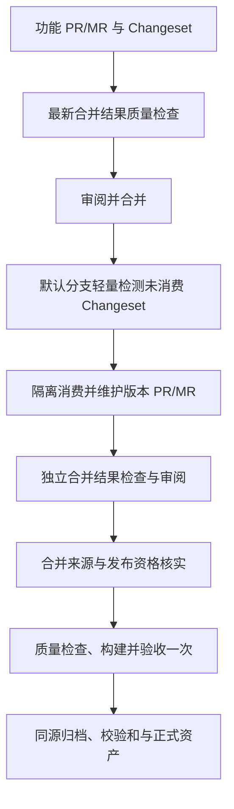

# 独立版本发布契约

各工作区包拥有独立版本，Changesets `fixed`、`linked` 均为空。私有包也更新版本与日志，但不上传 npm；根工具包不参与版本发布。版本传播仍遵循真实 workspace 依赖约束，不承诺永不提升依赖方版本。

## 本模板已实现与待启用范围

已实现独立版本配置、`pnpm changeset`、`pnpm version:packages`、双平台质量入口、本地验证与发布设计。自动版本 PR/MR 维护、目标分支更新调度器、正式资产上传没有启用；不得把下面的设计视为已运行的发布流水线。

当前正式交付单元规划为 webapp 的 `dist` 归档及 SHA-256 清单；共享配置包仅供工作区使用。没有 Docker、S3、注册表上传或生产部署。启用外部发布前须确定目标、身份和最小权限。

## 版本准备

开发者运行 `pnpm changeset`，用中文记录用户影响、patch/minor/major 及 OpenSpec change。纯规则或无行为文档维护可免 Changeset。仅在预期变更已合并、工作区干净时运行版本命令；模板验证在临时副本消费，保留工作区未发布变更。

自动维护的第一步只扫描事件源码树内存量 `.changeset/*.md`，排除 README、隐藏文件及元数据；不只看 push 改动路径。无候选时跳过准备依赖、版本生成和写入，有候选才安装固定 CLI 并验证格式及有效项。无有效项不创建空请求，格式错误明确失败。

在隔离干净检出运行 `pnpm version:packages`，允许改动仅包括对应 package.json、CHANGELOG、锁文件、消费的 Changeset 与来源记录。维护唯一版本请求，分支更新使用远端租约保护；正文管理块外的人工内容保留。API 结果未知先回读，旧运行不能覆盖新结果。版本准备不构建产品、不上传文件、不提前发布。

## 验收与执行信任

所有请求来源及实际目标更新，都应重新检查最新合并结果，覆盖非默认目标；目标重检与 Changeset 检测独立。核对请求编号、来源/目标项目、分支/SHA、合并提交及 run/pipeline 身份，在入场和回报前复核。冲突或过期身份失败，不能退回只验来源。按请求取消过期检查，不取消其他请求或正式发布。

实际安装、构建、测试、脚本与验证配置应来自同一合并结果。平台 CI 配置解析来源须单独核实：checkout 合并源码不等于平台重新解析该树中的配置。补充控制器只负责可信调度、许可和身份，不携带发布秘密执行未信任代码。合并审批与代码执行审批分开，外部贡献者遵循平台原生运行许可。

测试默认只记录结构化计数与日志，不上传报告、trace、转储或整个源码；零测试、缺失环境、跳过必需项不能报告通过。

## 正式资格与同源

正式构建前核实原仓库默认分支、受管理版本请求已合并、真实 merge/squash/rebase 来源、Changeset 消费证明、版本/锁文件/日志一致。仅有版本号、分支名、提交标题、手工标签或手工运行都不能授权正式发布。

构建并验收一次，所有消费者复用同一归档；清单绑定完整源码、包版本、构建身份、文件和 SHA-256。说明来自发布源码对应版本的精确 CHANGELOG 章节；缺失、重复或解析失败阻断。不能用最新分支补历史版本内容。

## 缓存与制品生命周期

默认只用可重建的本地 pnpm store 与 Turborepo 缓存，不开启远程缓存。不把缓存作为发布证明；不可信请求不得写正式发布共享缓存。引入 CI 缓存时按项目、运行时、锁文件和信任域隔离，验证相同输入、仅源码变化、锁文件变化以及缓存缺失的行为。

当前规划生产者和正式消费者可在同一作业完成，不需要临时跨作业上传。作业文件随执行器回收，正式归档独立持久保存。若以后拆作业，只上传明确需要的文件，以真实生产作业、生成尝试和对象 ID 绑定；全部消费者终态后由可信处理器精确回读并删除，有限过期兜底，不以分支/SHA 前缀批删，不碰正式资产。尾部 always/after_script 不能保证取消或执行器丢失时运行。删除失败单独报告，不能掩盖原始失败。

## 并发与恢复

同包/版本正式写入串行；同版本远端字节冲突失败，未知写入先回读，只补缺项。Latest 只有启用后才按 SemVer 向前推进，旧运行不得回退新版本。缓存损坏时重建。没有持久同源归档时重跑完整原生产链，不承诺只重跑下游；正式发布成功但后续步骤失败时修复同版本，不另造新版本。

依据：[design-pr-versionization](../.agents/skills/design-pr-versionization/SKILL.md)，上游固定为 `tellok/dotai@7f96019efc531774786892de1573b937e7274be9`。平台方案分别见 [GitHub](release-github.md)、[GitLab](release-gitlab.md)。
